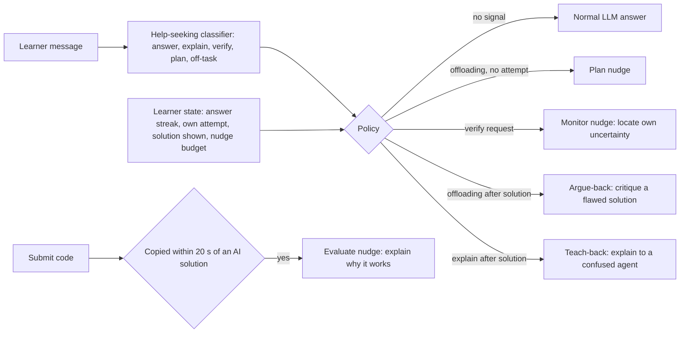

# metacog-tutor: a metacognitive layer for learning with generative AI

**Question:** when students learn with an LLM assistant, does a lightweight metacognitive layer
(prompts to plan, monitor and evaluate, plus argue-back and teach-back modes) help them keep
doing their own thinking? We measure success by what they can do **without** the AI afterwards.

It builds on research on metacognitive support for human-AI co-creation, over-reliance on AI,
help-seeking in intelligent tutoring systems, argumentation, teachable agents, and self-regulated
learning, and applies those ideas to learning to program with an AI assistant.

## Design



- **Two conditions**, balanced randomisation: *control* (plain assistant) and *metacog*.
- **Procedure (~45 min):** consent → pre-test (6 output-prediction items, no AI, no paste) →
  6 coding tasks with the assistant (auto-graded by hidden tests in a sandboxed subprocess) →
  isomorphic post-test (no AI, confidence 0–100 per item) → survey (workload, perceived
  learning, autonomy, open question on when the nudges helped or annoyed).
- **Transparency:** in the metacog condition, every nudge comes with its reason, and every
  policy decision is logged with that reason.
- **Guard-rails against gatekeeping:** a cooldown between nudges and at most 3 nudges per problem.
  The AI never withholds help indefinitely.

## Status

| Part | State |
|---|---|
| Web app (FastAPI + single-page frontend, SQLite event log) | ✅ runs: `uvicorn metacog.app:app` |
| Help-seeking classifier (TF-IDF + logistic regression; LLM zero-shot option) | ✅ seed set of 66 synthetic examples. **Needs hand-labelled data from the pilot** |
| Offloading detector + nudge policy | ✅ unit-tested (streak, cooldown, cap, fast-copy) |
| Simulator: synthetic participants through the real HTTP API | ✅ validates the whole pipeline |
| Analysis: ANCOVA, normalised gain, Brier/calibration, offloading over time, power | ✅ `python analysis/analyze.py data/sim_study.db` |
| Pilot with 3–5 learners (think-aloud) | ⏳ needs you, see `study/` |

**Tests:** `pytest -q` → 8 passed. This includes an end-to-end simulated study that checks
balanced assignment, that every event type is logged, that the control condition never
receives a nudge, and that the metacog condition does.

## What the simulation tells us before recruiting anyone

The simulator's behavioural model is an **assumption** used to test the pipeline. Its "effects"
are not findings. But the power analysis is real:

- with **n = 40 total**, the minimum detectable effect is **d ≈ 0.91** (80% power). Only a very large effect would show up.
- to detect a moderate **d = 0.5** you need **about 64 per group**.

So a 30–40 person study should be framed as a **pilot** (effect estimates plus qualitative
insight), or redesigned. Options: a within-subject design (each learner gets both conditions
on different concepts, counterbalanced), or a course deployment for sample size.
`study/PROTOCOL.md` recommends the within-subject variant.

## Run

```bash
pip install fastapi uvicorn httpx scikit-learn pandas statsmodels matplotlib pytest
uvicorn metacog.app:app --reload          # http://localhost:8000 (mock LLM if no key)
# real LLM via any OpenAI-compatible endpoint, e.g. Gemini free tier:
LLM_BASE_URL=https://generativelanguage.googleapis.com/v1beta/openai LLM_API_KEY=... LLM_MODEL=gemini-2.0-flash uvicorn metacog.app:app
python -m metacog.simulate --n 40 --db data/sim_study.db && python analysis/analyze.py data/sim_study.db
pytest -q
```

## Known limitations

- The classifier seed set is small and template-generated. The pilot's chat logs must be
  hand-labelled (two raters, report Cohen's κ) and the classifier retrained.
- In simulation, argue-back and teach-back only trigger once the AI has given a full solution.
  The mock LLM never does, so those branches are covered by unit tests only.
- Output-prediction items measure near transfer. Far transfer is out of scope for a 45-minute session.

## Demo and model files
- `demo/index.html`: a self-contained page (open it in any browser) that plays the same student messages to a plain
  assistant and to the metacognitive one, side by side, using the same decision rules as the app.
- `models/help_seeking_tfidf_lr.joblib`: the trained help-seeking classifier (loaded automatically by the app);
  `models/help_seeking_tfidf_lr.json` gives its metadata and cross-validated accuracy.
- `data/sim_study.db` and `analysis/out/`: an example simulated study and its analysis output.
